# Cinema Craft

**English** · [简体中文](README.zh-CN.md)

Cinema Craft is a Lumina Canvas Agent skill by Xianlin-lu. Start with a short film idea and develop it into a script, approved production assets, generated footage and an editable cut. You review key decisions on the canvas, and the agent continues when your answer is returned.

[Download v6.12 for Lumina](dist/lumina-cinema-craft-v6-12.zip) · [Skill source](skills/lumina-canvas-film/) · [Workflow requirements](docs/requirements.md)

## What's new in v6.12

Version 6.12 adds authorized reference recovery, one layout check per character-sheet version, script-linked Pinterest composition and locked native Sunburst image settings. Seedance 2.5 uses a single supported generation for supported durations up to 30 seconds and a first segment plus extension above 30 seconds. Completed video batches present native editing choices before Shotcraft-informed editing.

## Hands-on tutorial

Before starting, check that your Lumina environment exposes native Question cards, image and video generation, task status and Video Editor. Choose a duration and aspect ratio if your project requires them. The default video ratio is 16:9.

[Watch or download the finished demo film](docs/media/cinema-craft-tutorial/cinema-craft-demo.mp4) (MP4, 73.8 MB).

### 1. Import the skill

Download and extract the ZIP above. Create a blank skill in Lumina and import the extracted `SKILL.md`, `agents/` and `references/` together. To update an older installation, back it up and replace the complete set so stale references do not remain. The entry point displays `Import build: v6.12-native-batch-flow`. The package contains 46 files and 59 complete style specifications.

| Open the Skill panel | Create a custom Skill |
| --- | --- |
| 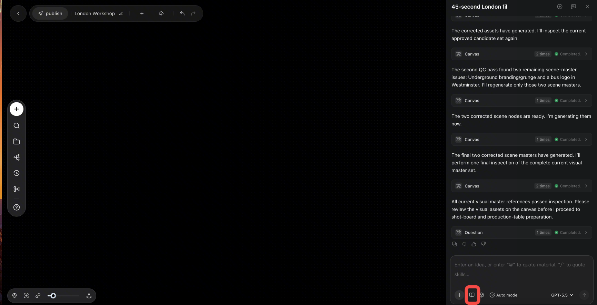 | 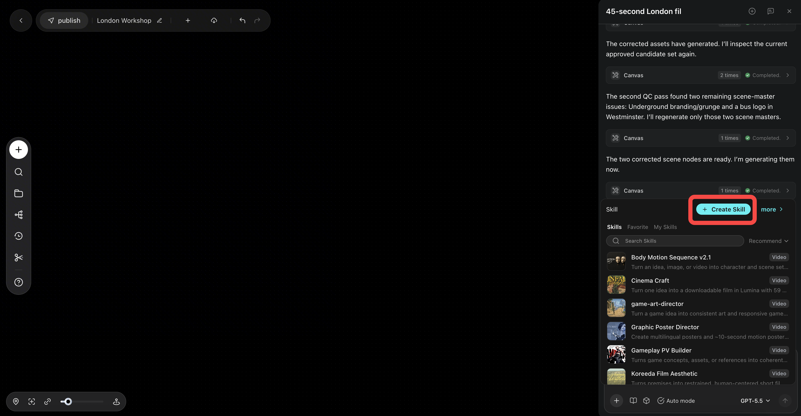 |

| Enter the Skill details | Upload the package | Save the Skill |
| --- | --- | --- |
| 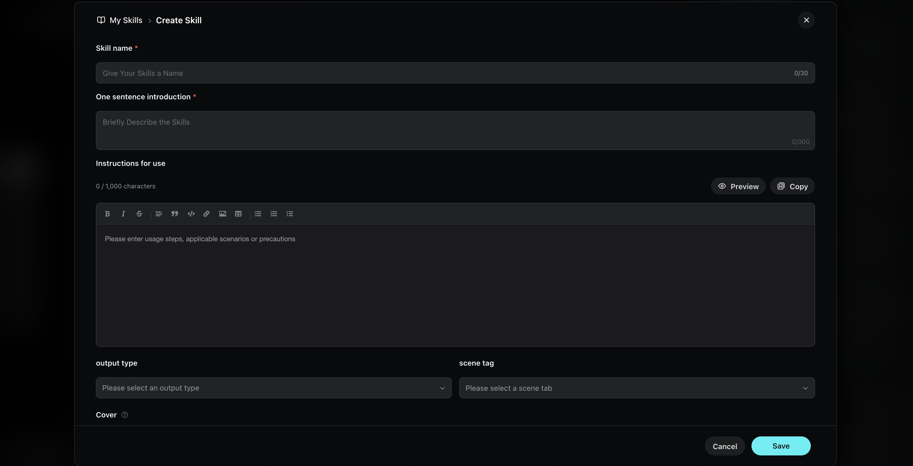 | 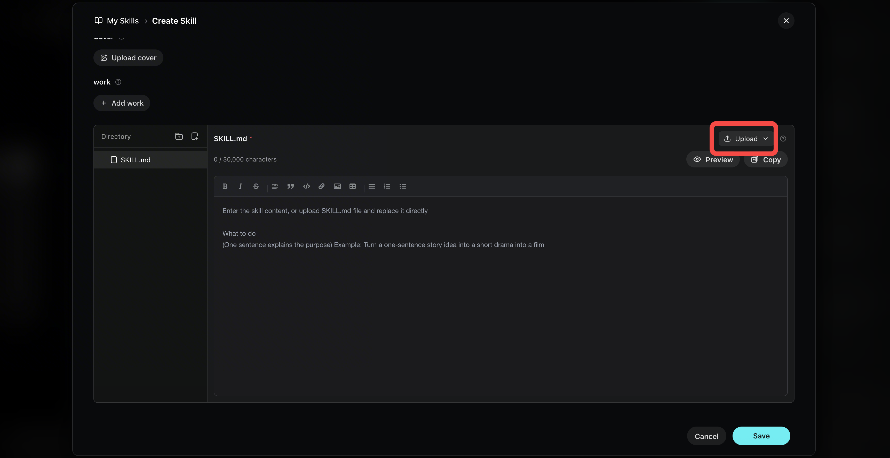 | 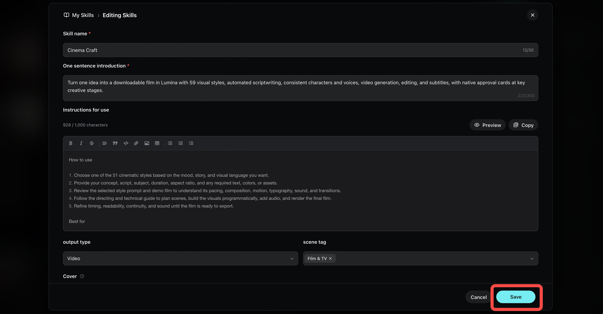 |

### 2. Start with an idea

Open your canvas, select Cinema Craft, and send a brief. You can paste this example and change the setting, duration or style.

> Create a 25-second, 16:9 live-action microfilm. On the last train home, a passenger finds a folded note in a library book. Tell the story through glances and small gestures, with one spoken line, natural train ambience and a quiet ending.

If you have approved images or video references, add them to the project. The agent can also research accessible Pinterest visuals and draw composition cues from material it actually inspected.

Switch the canvas from manual mode to auto mode before sending the brief.

| Manual mode | Auto mode |
| --- | --- |
| 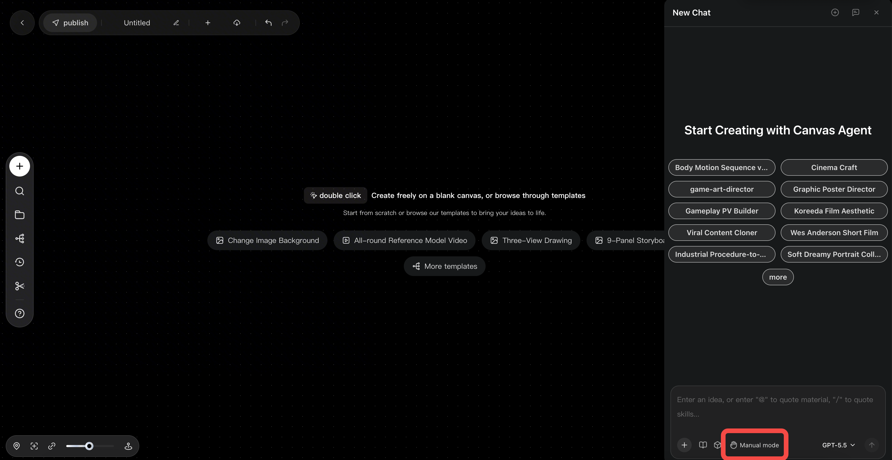 | 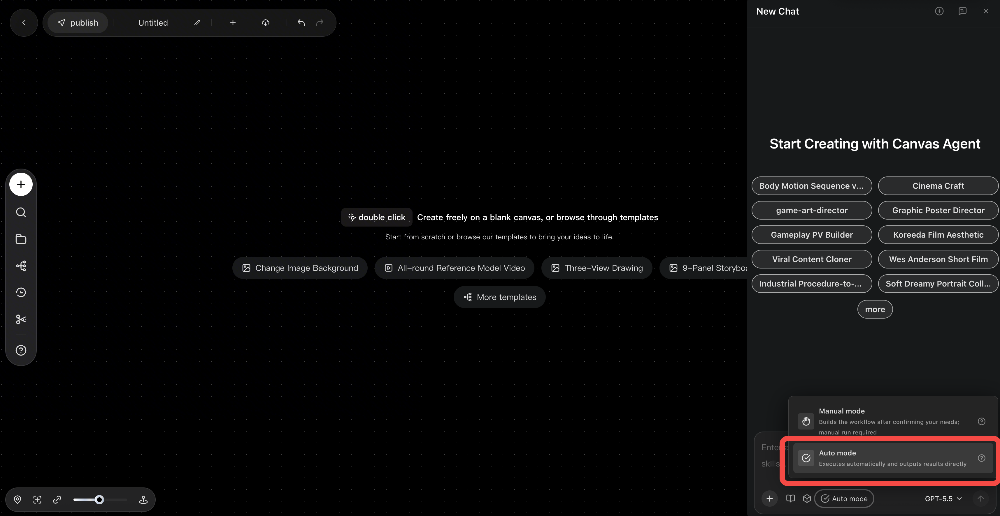 |

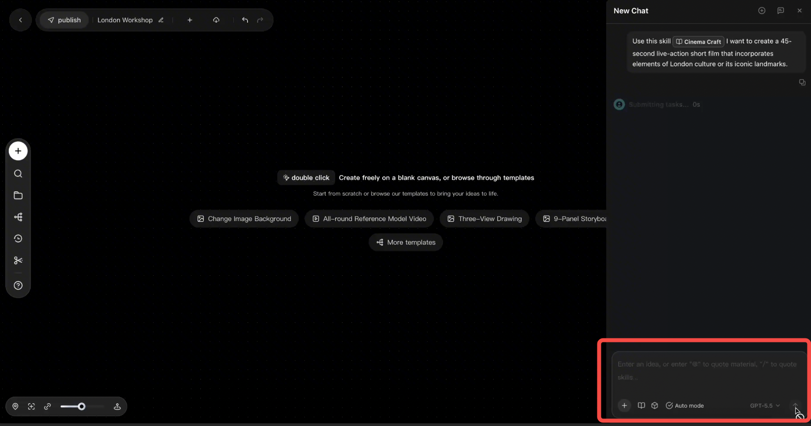

### 3. Confirm the script and style

Open the complete script on the canvas. Check the characters, scenes, dialogue, pacing and ending. Use the native Question card to approve or request a change. The card identifies the version under review so the script stays readable on the canvas.

| Confirm the creative direction and style | Review the complete script |
| --- | --- |
| 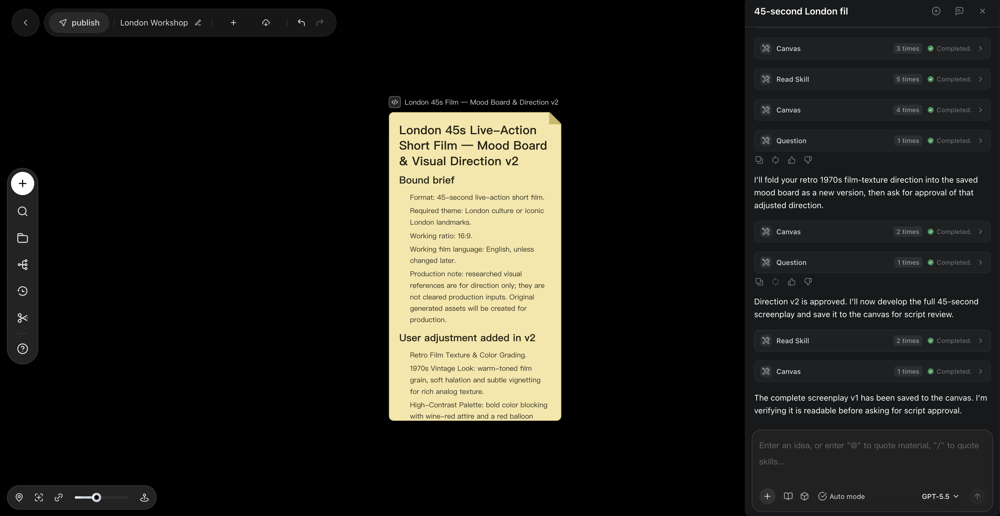 | 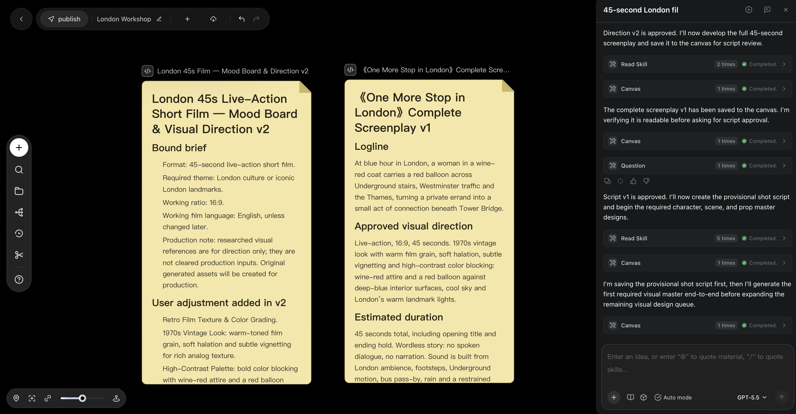 |

### 4. Review character, scene and prop references

Confirm the assets on the canvas. For a character sheet, check the close-up on the left and the three full-body views on the right.

| Image | Native model | Native `quality` | Native `image area` | Framing |
| --- | --- | --- | --- | --- |
| Character sheet | GPT Image 2.5 Sunburst | `medium` | Off | 16:9, frontal close-up on the left, full-body front, profile and back views on the right |
| Storyboard | GPT Image 2.5 Sunburst | `medium` | Off | Approved project ratio and script-linked composition |

The agent reads the active Lumina schema and applies the exact native keys and values. These settings also apply when it repairs a character sheet or storyboard.

| Shot overview | Character sheet | Prop reference |
| --- | --- | --- |
| 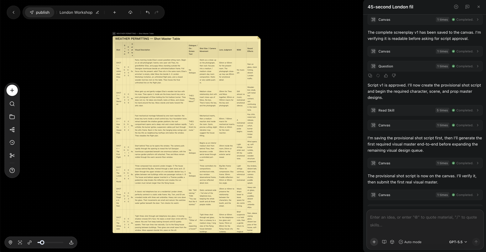 | 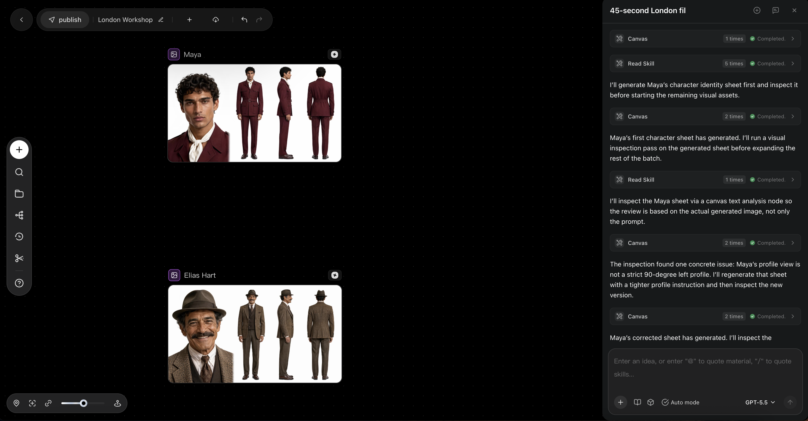 | 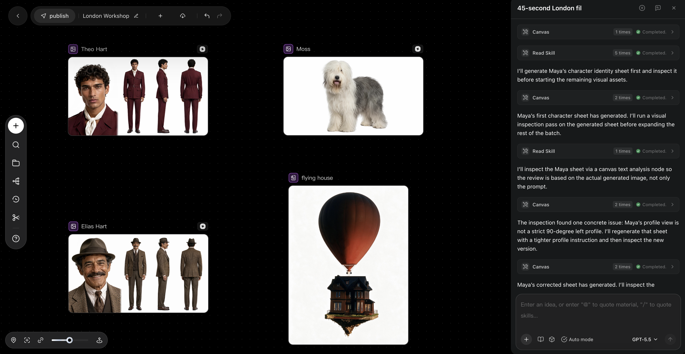 |

### 5. Approve voice auditions

For each speaking character or narrator, choose a voice on the native card and listen to the actual audition. Auditions are typically 20–30 seconds. Production dialogue and narration use the approved voice.

| Review the voice audition | Generate the production voice |
| --- | --- |
| 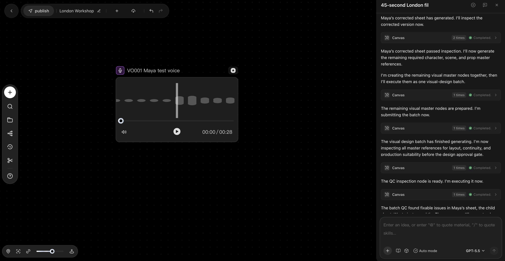 | 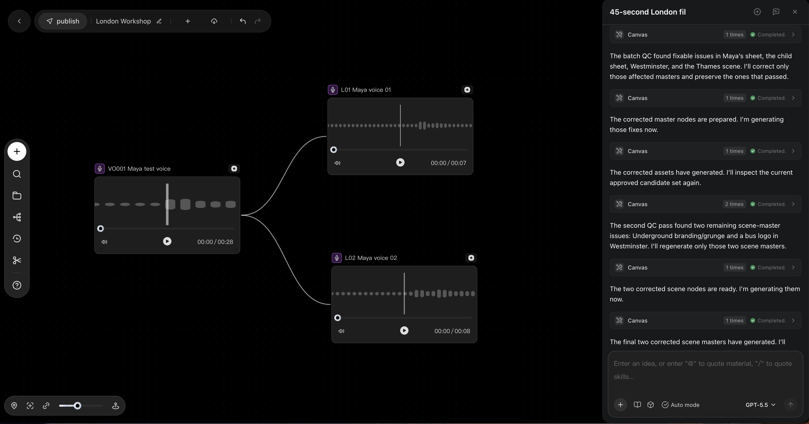 |

### 6. Review the shot production table and boards

Read the complete shot table on the canvas. Review the time ranges, visuals, dialogue, shot sizes, focal-length choices, music cues and effects against the approved script and storyboard images. Confirm the current versions together on the native card.

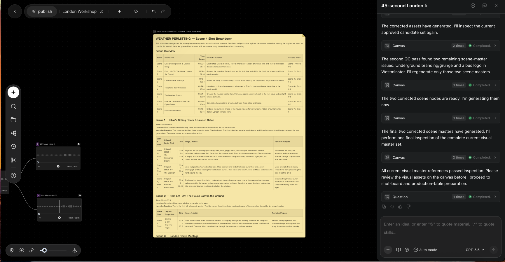

### 7. Generate and review footage

When supported by the native model, Seedance 2.5 generates films up to and including 30 seconds in one job, using timed beats within that job. Longer work starts with an approximately 30-second segment and uses native extension for eligible continuity. Separate scenes may require independent generation and a hard cut. Let the batch finish, then review playback, dialogue, narration and effects. Use the native card to request a targeted rerun.

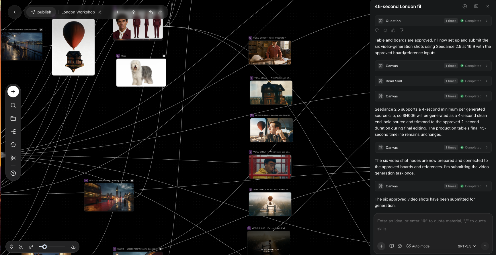

### 8. Choose the edit

After footage approval, choose **Generate without subtitles**, **Subtitles only** or **Stitch + subtitles (recommended)**. Lumina supplies the custom input when available. The native Video Editor carries out the selected scope, preserves speech and effects, and adds authorized background music on a separate track when appropriate.

| Open the editor | Edit the timeline | Export the film |
| --- | --- | --- |
| 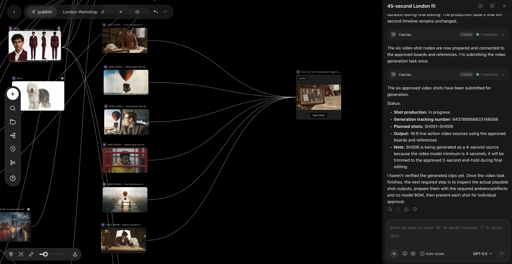 | 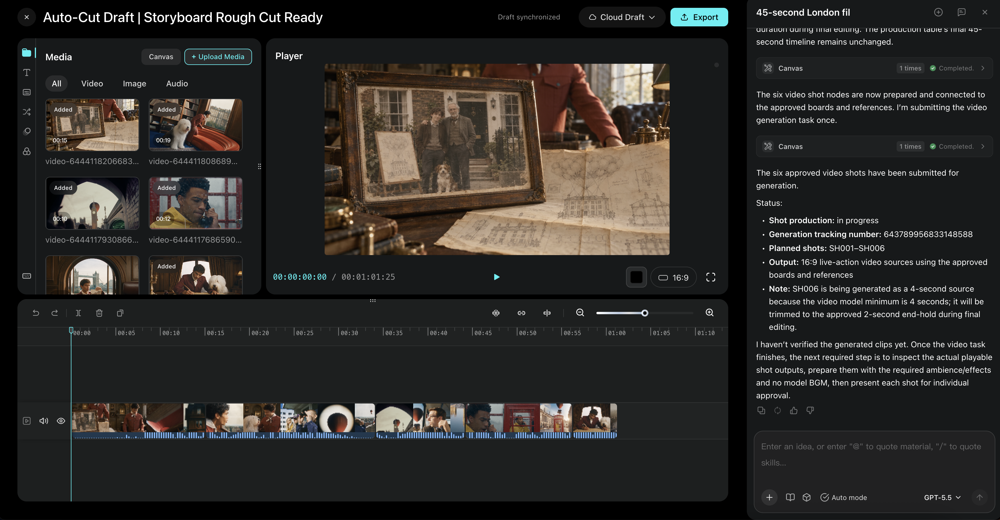 | 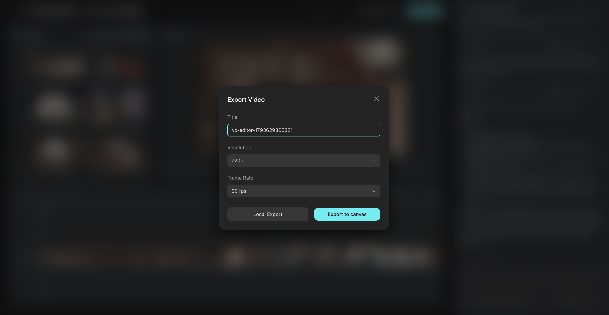 |

### 9. Confirm and export

Watch the actual editor preview. Use the native card to approve or describe a change by shot, timestamp or track. After approving the current revision, open the exported file and check playback, aspect ratio, audio, subtitles when requested, and access to the download.

[Open the finished demo film](docs/media/cinema-craft-tutorial/cinema-craft-demo.mp4).

## Further reading

- [Native editing workflow](docs/native-editor-workflow.md)
- [Research-to-film workflow](docs/v6-research-to-film.md)
- [Skill entry point](skills/lumina-canvas-film/SKILL.md)

<details>
<summary>Previous versions</summary>

Version 6.11 repairs affected shots and automatically assembles the complete QC-ready set in Lumina Video Editor. The draft is scored and synchronized to observed beats before final review. Suno Discover supplies optional music inspiration. Export uses the approved preview revision.

Version 6.10 requires a single white 16:9 sheet with a complete frontal face close-up on the left and full-length front, left profile and rear views on the right. Each criterion is verified on the actual image. Character design follows the brief, and scene prompts connect wardrobe details, palette, physical interaction and emotional beats.

Version 6.9 starts creative research with Pinterest cinematic aesthetic imagery and selects relevant, verified four-star-or-higher media from the authorized Lark view and video posts from the specified Xiaohongshu creator. Observed reference segments guide target shot framing, camera paths, rhythm and presentation. The public package takes the private Lark view from project configuration.

Version 6.8 saves the first three draft shots and cut cues on canvas before optional questions. Two consecutive clarification/confirmation turns with no useful saved artifact trigger a reversible draft or the next scoped artifact. Existing work is reused. After the board repair limit, save a usable overview, disclose nonblocking limitations and ask once only for material tradeoffs. Reconcile failed native card responses separately from media tasks. Scope mutable state to the active project, canvas and session; committed production and export approvals still apply.

Version 6.7 authors only **Generate without subtitles / Subtitles only / Stitch + subtitles (recommended)** in the post-production card. When Lumina adds native Other, do not author Other/Custom or a translated duplicate; use exactly one actual custom-input route. Generate without subtitles replaces legacy Stitch only and produces one edited, reviewed, downloadable film with intended sound and final scoring, without dialogue subtitles. Existing subtitle clips/tracks are removed in the same draft while titles and required in-scene text are retained; changed previews require final approval before export. Disabling subtitles does not supply missing native editor/export capability or authorize separate-clip delivery. Native card behavior and editing/export have not been exercised for this release.

Version 6.6 removes hardcoded Chinese from the canonical English entrypoint, runtime references, native choice examples, style index and invocation metadata. The actual project request still determines output language. Every authored reply, canvas title/script/table cell, asset description and card field is checked before display or review; existing mixed-language artifacts are repaired in place without regenerating unchanged media. The 59 full original style specifications remain byte-identical internal references, never bilingual UI templates. The builder rejects hardcoded CJK in English runtime templates while preserving original style fragments. Native parameter spelling remains unchanged. Source, package and hash checks passed; this release has not been run end to end in Lumina.

Video defaults are **Seedance 2.5** and **16:9** unless the user explicitly requests another ratio. Remove ONLY model-generated background music before shot review; retain or restore all intended dialogue, off-screen speech, narration, sound effects and ambience. Prepared shots must actually play with their required sound before approval; a globally muted intermediate or detached audio is incomplete. Use true extension only for eligible continuous shots in the same scene; separate scenes remain independent. All visual transitions are hard cuts.

Version 6.5 defaults character/family sheets and storyboard images to **GPT Image 2.5 Sunburst**, native **quality: medium**, and native **image area OFF**. Exact UI labels/case were inspected in Lumina; callable keys still come from the active native schema, not invented aliases, public-API examples or maintainer validation fields. Verify actual configuration before dispatch; never silently switch model/quality or enable image area during repairs. Keep sheet/project aspect ratios independent. UI inspection is not a native generation test.

Version 6.4 keeps the entire user-facing workflow in the user's project language. English requests produce English replies, canvas titles/scripts, every shot-table heading and narrative cell, Question titles/options and final handoffs. The English table uses Scene / Shot ID, Start Time, End Time, Visual Description, Dialogue, Shot Size, Focal Length Rationale, Background Music and Sound Effects. Existing mixed-language tables are repaired and read back in place, preserving IDs, approved content and media; display localization alone does not authorize translating locked dialogue or regenerating assets.

Version 6.3 adds one clear frontal face close-up plus front/left-profile/back full-body character views in a 16:9 sheet. Script-supported relatives derive from approved canvas image handles and versions; the relation occupies XXX in the short prompt template, while the source character is actually attached as an image. Shared traits support resemblance without copying the source identity. A conditional anchor approval resolves missing approved references before dependent generation; all relatives still need final visual approval.

Version 6.2 also saves and reads back the complete shot production table in real readable canvas nodes before review, with every shot and all nine existing columns intact. Actual shot boards and speech previews stay associated with their canvas rows/versions. Question contains only a concise version locator and decision/change controls, never table rows/cells. Revisions update and verify the canvas artifact before approval; paging preserves every row, and failed writes cannot be replaced by card content.

Version 6.1 saves the complete screenplay in a real readable canvas text/document node and verifies the saved version before asking for approval. Native Question cards contain only the locating question and decision/change controls, never the screenplay body. Revisions update and verify the canvas script before a new version-specific card; missing/failed canvas writes preserve a recovery point rather than substituting a card or chat transcript.

Version 6 first inspects a real source-backed Mood board and derives 5–10 keywords, then offers Lumina-native approval of the researched direction, an actual library style or targeted adjustment. Pinterest queries use a supplied relevant name plus film aesthetic, or film aesthetic when unnamed, with brief-specific location/theme research. Engagement is cited only when visible; unavailable metrics are labeled, never invented. Search references do not automatically become licensed production inputs.

The self-contained screenwriting adaptation follows the selected repository's short-film workflow: premise/theme, structure, character/conflict, scenes, dialogue, format and diagnostic revision. Explicit duration ranges remain binding through export; feature-page counts are not forced into a short. Approved scripts produce a provisional shot script before paid design; real scene references and actual composed shot boards are generated, inspected and refined only for diagnosed defects through native image tools. Initial masters share one native visual approval; the final measured table and all current boards share the existing table gate before video. [Method provenance and license](docs/screenwriting-notice.md).

The agent turns the approved direction into a complete script, **16:9 character turnarounds**, role-specific voice choices, real **20–30 second auditions**, a measured shot production table and every planned video shot. Each current shot is then reviewed through a native Question card before post-production begins. A persistent reconcile/dispatch loop advances every ready authorized task after native answers and actual tool results; host callbacks/status APIs provide asynchronous continuation.

After script approval, the agent automatically reads the full script, extracts and deduplicates its on-screen cast, infers compatible unspecified appearance details, and generates each required character's optimized identity sheet in ONE landscape 16:9 image through native image tools: one sharp frontal face close-up PLUS front, strict left-profile and back full-body views, with all visible faces clear. Script-supported relatives use actual approved canvas image/version references, with distinct target identities and restrained family resemblance. If no approved anchor exists, generate and obtain one conditional native anchor approval before dependent relatives; final combined asset review still covers every generated relative. No manual cast list, portrait upload, node creation or per-character continue action is required. The first-item dispatch order is internal; all required real sheets are completed and inspected before the existing native character-image approval, then voice work begins. Narrator-only voices and ordinary props/locations are classified separately.

Version 5.6 also automatically detects important close-up and recurring objects, including important background props and decorations. It generates actual reusable prop references (16:9 by default), tracks identity/state/placement and maps each appearance to approved real assets in the master table and supported native shot inputs. Initial props share the applicable character/prop visual review; ordinary incidental clutter stays scene-level. Newly required close-up assets receive targeted incremental review before dependent shots without restarting unrelated work.

Version 5.2 distinguishes prepared nodes, accepted jobs and real outputs. It completes the first required character deliverable before expanding the queue, serializes shared-canvas writes, and handles pre-execution sync faults with bounded non-generating reconciliation. Existing nodes, running tasks and completed media are reused; uncertain acceptance never triggers a blind duplicate paid submission. Persistent host failures retain a precise checkpoint and use actual native recovery rather than promising unsupported background resumption.

Version 5.4 makes operation-specific audio input preparation mandatory BEFORE every submission: actual text/voice/reference types, saved bindings and exposed registration/readiness are resolved first. A failed shared input path holds its unsubmitted queue, and only observed repairs with resolved acceptance permit bounded retries. This avoids repeating invalid calls for every character; it cannot suppress Lumina's own error dialogs or repair hidden backend registration services.

Version 5.5 adds an explicit visible scene description to every shot row: concrete subject experience, action, spatial/sensory interaction and observable result. Abstract design advice and unsupported benefit claims are rewritten before table review, consistently with the approved script, board, timing and sound. Reference examples supply the writing principle only, not story content or automatic new POV/narration.

Version 5.7 compiles character prompts in three modules: sheet layout/consistency, the approved style with neutral readable lighting, and concrete identity/face/makeup/costume/proportion design. Optional aesthetic direction follows the script rather than forcing a perfect face or photographic medium onto every style. That historical blur/layout is superseded by v6.3; clear frontal close-ups and three full-body views drive identity/costume references. Existing good approved assets and the native review sequence are preserved.

Version 5.8 makes project start/end times, the existing single scene description, exact speech, shot size, reasoned focal-length direction, final-editor BGM plans and shot effects visible as separate master-table columns. Planned cumulative time, measured source clips and edited time remain distinct. Lens values are full-frame-equivalent proposals or explicitly inapplicable for flat/orthographic work, not fabricated measured metadata.

The next card authors **Generate without subtitles / Subtitles only / Stitch + subtitles (recommended)**; native Other is the single custom-input route, not another authored business choice. Choosing both invokes Lumina's native Video Editor for assembly and editable captions. The agent automatically fits original/cleared final scoring to the story, mood and pace through supported native tools, respecting explicit no-music choices. Picture, final background music, selected subtitles and sound effects remain on real separately editable tracks, with correct embedded or dedicated speech and no doubling. Meaningful cuts follow genuine musical markers while preserving dialogue, effects, actions and synchronization. Final scoring is reviewed in the actual preview before export.

Final review offers **confirm and export / continue modifying / preview again**. A modification is specified inside the native card, then applied to the same editor project. The loop repeats for the current revision until approved. The agent exports through the native editor, checks the actual accessible media and returns the downloadable result; an editor draft is not a completed export. If the user explicitly declines post-production, delivery is clearly labeled as approved clips.

All **59 styles** retain their full specifications. The importer package contains **46 text files** (49 items including directories/root) and uses a conservative 29,600 UTF-16-unit cap under the user-confirmed 30,000-character limit. Existing audio-ID, voice ownership, duration, extension-ratio, bounded recovery and policy-rejection rules remain included. The previous release explanations above remain historical context; v6 adds the research/direction and actual scene/board/refinement stages. Every approval is version-specific; missing host tools or provider failures are reported honestly. This update verifies rules and packaging; native web/Pinterest search, image refinement, generation/attachment, audio repair, editing/export and the paid-media pipeline have not been exercised end to end for v6.

</details>

## Maintainers

```sh
python3 tools/build_lumina_skill.py
python3 tools/build_lumina_skill.py --check --zip dist/lumina-cinema-craft-v6-12.zip
# Repack existing verified style text without needing the source library:
python3 tools/build_lumina_skill.py --repack-existing --zip dist/lumina-cinema-craft-v6-12.zip
# Check/package the current import folder:
python3 tools/build_lumina_skill.py --verify-import --zip dist/lumina-cinema-craft-v6-12.zip
```

The builder verifies importer counts, filenames, 29,600-unit text lengths, local reference links, canonical English runtime-template text and reconstructed style hashes. The source-language lint does not restrict runtime output in the actual user language; original style fragments are exempt and hash-verified. The 59 complete specifications are losslessly repacked into 27 style pages; no style is summarized or removed. `tools/lumina_preflight.py` provides existing normalized media checks; it is not the native runtime orchestrator and does not replace v5 approvals. Helpers, historical tests, documents and ZIPs stay outside the import folder. The separately preserved toolkit and media live in `xianlin-lu/`; follow their corresponding notices.

Editing-method mapping and reference revision: [Native editor workflow](docs/native-editor-workflow.md). The OpenFilm method is adapted to Lumina's native operations; OpenFilm Studio/CLI is not installed or invoked by this Skill. [Source notice](docs/openfilm-notice.md).
